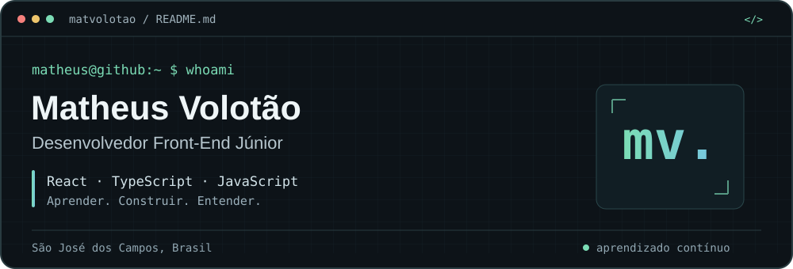
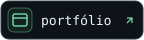

### Um pouco sobre mim

Oi! Sou o **Matheus**, desenvolvedor front-end júnior e bacharel em Ciência da Computação pela Unifesp. Gosto de aprender construindo e entender melhor as soluções que aplico.

Hoje meu foco está em **React, TypeScript e Tailwind CSS**, enquanto aprofundo meus estudos em **back-end no DevQuest**. Uso IA como apoio ao desenvolvimento e ao aprendizado.

### Tecnologias que uso

  &nbsp;
  &nbsp;
  &nbsp;
  &nbsp;
  &nbsp;
  &nbsp;
  

---

  
  
  

